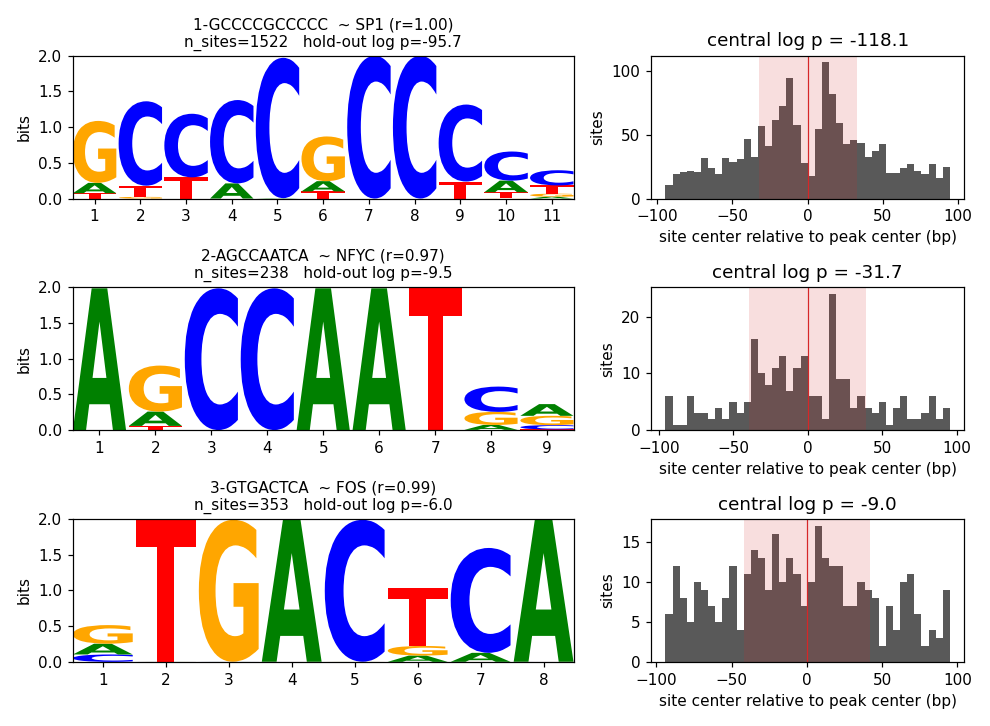

# Using pystreme

De novo motif discovery from Python, in-process, on the GPU. This is the
practical guide; `DESIGNDOC.md` has the reasoning, `BENCHMARKS.md` the
validation against real STREME.

## Install and run

```bash
./scripts/setup_env.sh          # creates the `pystreme` conda env, editable install
conda activate pystreme
pytest                          # CPU-only correctness suite, ~30 s
```

`fit` needs a GPU to be fast (on a CPU the same code is several times
slower; the correctness suite runs anywhere). On a shared cluster that
means a job on a GPU node, never the login node; see
[Running on a cluster](cluster.md).

Memory: reserve at least 4 GB for anything that imports torch; 16 GB is
comfortable for tens of thousands of 200 bp peaks.

## The two-line version

```python
from pystreme import MotifDiscovery, summary

disc = MotifDiscovery.from_bed("peaks.bed", "genome.fa", size=200, device="cuda")
motifs = disc.fit(n_motifs=3)
summary(motifs)
```

`from_bed` takes a BED (the 4th column becomes the peak name) and an
indexed FASTA (`.fai` alongside), and extracts `size` bp centered on each
peak -- HOMER `-size` semantics. The centre is the summit when the file is
a narrowPeak (exactly 10 columns; the 10th is the summit offset from the
start, -1 for none), and the interval midpoint otherwise or with
`summit="midpoint"`. A pre-parsed list of `Interval` can carry `summit=`
(an absolute coordinate). Peaks that would run off a chromosome end, name
an unknown chromosome, or are more than `max_n_frac` N are dropped with
one warning; so are peaks whose window is identical to an earlier one
(reason `"duplicate"`). `disc.store.excluded` lists them with reasons.
Windows that overlap without being identical (several MACS summits in one
region, say) are kept with a warning: they share sequence, so `fit` keeps
each overlapping cluster on one side of the hold-out split, but they
still count separately in every test, so merge peaks closer than `size`
if they are one binding event. If midpoint-centred peaks are broad
(median width more than twice `size`) you get a warning: fixed windows
assume the center is meaningful, so use summits where you can. `from_fasta` (equal-length sequences in a FASTA) and `from_sequences`
(a list of strings) exist for sequences that did not come from a genome.

## What `fit` does and what its arguments mean

Each call: build a control set, split primary and control into training
and hold-out, then repeat -- find the best motif on the training set,
re-test it on the hold-out, report it, erase its sites, go again -- until
the stopping rule fires.

| argument | default | meaning |
|---|---|---|
| `primary_idx` | all | row indices into `disc.store`, or a boolean mask over it, that count as "primary" (e.g. one cluster of peaks); the control is built to match that subset |
| `n_motifs` | 3 | stop after this many *significant* motifs |
| `pvalue_thresh` | 0.05 | a motif counts if its hold-out p-value is at most this |
| `patience` | 3 | also stop after this many consecutive insignificant motifs |
| `keep_insignificant` | False | return the rejected motifs too (they are erased before continuing either way, as in STREME) |
| `widths` | 6..15 | motif widths to seed; the final width is settled per motif (see below), so this is a range to search, not a menu |
| `control` | `"dinuc_shuffle"` | see "Controls" |
| `holdout_frac` | 0.1 | fraction of primary (and control) held out for significance; primary sequences that are identical or overlap on the genome are held out together; hold-out is skipped with a warning below `min_holdout=10` sequences per side |
| `seed` | 0 | seeds the control construction and the split; same seed, same result |
| `n_per_width` / `n_iter` | 4 / 20 | seeds refined per width, refinement iterations per seed -- the cost knobs; STREME's own defaults are similar |
| `bg_order` | from `from_bed` (2) | Markov order of the background model, fit on the control set |
| `kernel` | `"auto"` | scan kernel; `"gather"` (default on CUDA) or `"conv"` (fp16 one-hot) |
| `min_flank_ic` / `width_tolerance` | 0.3 / 2.0 | width settling: trim/extend flank columns below/above this many bits; treat widths within this many nats of the best p-value as tied and prefer the more informative motif |
| `verbose` | False | print one line per round |

The constructor (`MotifDiscovery(store, widths=..., control=...,
holdout_frac=..., revcomp=..., seed=...)`, and hence `from_bed(...,
widths=...)`) sets per-object defaults for the same names.

### Controls

- `"dinuc_shuffle"` (default): each primary sequence shuffled preserving
  its dinucleotide counts, N positions fixed. `control.DinucShuffle(kmer=3)`
  preserves trinucleotides instead; `n_per_seq=2` makes two shuffles per
  sequence. Compiled with numba when available (`engine="python"` forces
  the reference implementation). The two engines draw different shuffles
  from the same `seed`, so a run is reproducible only on machines that
  agree on whether numba is installed; pass `DinucShuffle(seed=...,
  engine=...)` explicitly when results must match across environments.
- `control.GCMatched(pool=SequenceStore)`: sample from a pool of candidate
  regions (e.g. all accessible regions, or peaks of another factor) to
  match the primary set's GC histogram. Read `DESIGNDOC.md` §2.6 before
  using it on a GC-rich factor: it can make the true motif look weak, and
  that is information, not a negative result. Primary sequences in a GC
  bin the pool has nothing in are matched from the nearest bin it does
  have, with a warning reporting the GC gap that leaves.
- `control.Explicit(...)`, or just a `SequenceStore`, a list of strings,
  or an index array (or boolean mask) into `disc.store`: your own control
  set. `n_per_seq` does not apply to it (repeating fixed sequences would
  only add copies) and raises.

`fit`, `discover` and `enrichment` score the primary set under a background
fitted on the control, but leave `disc.store` (and its background) as it
was: `disc.scan(...)` gives the same answer whatever ran before it.

### How a motif's width is decided

The enrichment objective saturates once a motif separates primary from
control as well as the data allows, so a motif one column shorter or
longer scores within noise of the same p-value. `fit` therefore trims
flank columns carrying less than `min_flank_ic` bits, grows the motif
outward while the next column carries at least that much, and among
widths whose p-values are within `width_tolerance` nats prefers the most
informative one. Reported widths are usually the informative core; real
STREME tends to report the same motif with a couple of degenerate flank
columns.

## Reading a `Motif`

```python
m = motifs[0]
m.consensus      # 'GCCCCGCCCC'  (N where no base reaches 40%)
m.pwm            # (4, w) probabilities, rows A C G T
m.holdout_logp   # natural-log p-value on the held-out sequences  <- quote this one
m.log_pvalue     # natural-log p-value on the training set: selected, optimistic
m.n_sites        # primary sequences whose best site clears m.threshold
m.sites          # best score / position / strand for every primary sequence
m.positions      # passing-site centers relative to the peak center (bp)
m.central_logp   # CentriMo-style central enrichment vs uniform placement (Bonferroni over window sizes)
m.central        # ...with the winning half-width and counts
m.decoy_central_logp  # central beyond the motif's composition: vs uniform AND vs decoys
m.decoy_central       # ...the decoy comparison: half-width, counts, .fold, decoy site offsets
```

Two p-values on purpose. The threshold was chosen on the training
sequences to be as significant as possible, so `log_pvalue` overstates;
`holdout_logp` re-tests that fixed threshold on sequences the search never
saw and is what `fit` uses to accept a motif. It is `None` when there was
no hold-out (`discover()`, or too few sequences), and then `log_pvalue` is
all you have. Both are natural logs: `exp(m.holdout_logp)` is the p-value.

Central enrichment is the second thing to look at, and `decoy_central_logp`
is the version to read. The bound factor's own motif is usually sharply
central and co-factors much less so. But base composition also changes
towards the summit of most peak sets (GC rises at promoter and CpG-island
peaks), so a GC-rich motif's best sites drift to the centre whether or not
anything binds them, and `central_logp`, which compares with uniform
placement, reads that drift as central binding. On synthetic GC-cored
peaks, a GC-rich matrix with nothing planted scores `central_logp` around
-200 to -350.

`decoy_central_logp` controls for it. Each motif gets `n_decoys` (default
10) decoys: its own matrix with the columns shuffled, so the same base
composition and information content but not the site. They are scanned on
the same peaks, and each contributes its best site in its top `n_sites`
peaks. The motif counts as central only if its sites are more central than
uniform placement *and* more central than its decoys'; the reported value
is the larger of the two p-values. Both conditions are needed: in GC-cored
peaks an AT-leaning motif's decoys are pushed out of the centre, and
uniformly placed sites would look central next to them. `plot.positions`
draws the decoys' sites as a line, so a motif that only follows the line
is following composition. Two limits. Decoys of a low-complexity motif (a
run of Gs) still partly match the motif, which makes the test
conservative. And column shuffling keeps base composition, not
dinucleotide steps, so a motif whose signal is mostly CpG content is
controlled for GC but not for CpG.

A motif with strong enrichment and no central signal is worth a second
look: a co-occurring element, or a peak set whose centres are not summits.

Repeated `fit` calls over overlapping subsets, selecting on the results,
quietly undo the hold-out guarantee (`DESIGNDOC.md` §5). Vary `seed` per
call and keep an untouched set of peaks for a final check if that is the
workflow.

## Tables, names, figures, files

```python
from pystreme import summary, annotate, plot

summary(motifs)                       # one row per motif
motifs[0].sites_frame()               # one row per peak: chrom/start/end, best site coordinates, strand, passing
ann = annotate(motifs, "H12CORE_meme_format.meme", top=3)   # Tomtom-style Pearson ranking vs a MEME database
plot.report(motifs, annotation=ann)   # logo + positional histogram per motif, most significant first;
                                      # ann = annotate(...) puts the best database match in each title
plot.logo(motifs[0]); plot.positions(motifs[0])
disc.to_meme(motifs, "motifs.meme")   # MEME minimal format, for Tomtom/FIMO/gimmemotifs
disc.to_bed(motifs, "sites.bed")      # BED6 of every moodspy site (p < 1e-4): chrom start end motif|peak score strand
```

`fit` returns motifs in discovery order (one per round). That order is
only roughly monotone in significance: each round takes the best motif
of what is *left* after erasing the earlier sites, and the hold-out
re-test is noisy. `plot.report` therefore sorts by hold-out p by default
(`order="round"` for discovery order); `summary(motifs, order="pvalue")`
and `sort_by_pvalue(motifs)` do the same for tables and lists. Names keep
their round prefix, so `3-GCGCNTGCGCA` is still round 3 wherever it sits.

Sites are called with [moodspy](https://github.com/vmindel/moodspy), the
MOODS port: every placement on either strand whose log2-odds score reaches
the motif's exact p-value cutoff (`p_cutoff=1e-4` by default, FIMO's
default), against the store's order-0 base composition. Hits of one motif
that overlap in a peak are collapsed to the best-scoring one (moodspy's
`remove_overlaps`), so a palindrome's two strands and the shifted copies
of a low-complexity motif in a G-run count as one site; `overlaps=
"opposite"` collapses only `+`/`-` pairs and `overlaps=None` keeps every
placement. A peak can carry several sites or none. Load the BED in a genome browser next to the peaks,
or intersect it with other annotations.

Two views of the sites, kept apart on purpose. `sites_frame()`,
`n_sites`, `positions` and the central-enrichment tests are `fit`'s own:
one best window per peak, scored in nats against the order-k background,
cut at the threshold `fit` chose. `disc.scan`/`disc.to_bed` are the
moodspy calls, for reporting and downstream overlap. Their scores are in
bits against an order-0 background, so they are not comparable with
`Motif.threshold`. `pystreme.sites_bed(motifs, path)` still writes `fit`'s
one-per-peak view as BED.

`plot.report(motifs, annotation=ann)` on the first 2000 SP1 ChEC-seq peaks (the
run recorded in the benchmarks), most significant first, with the HOCOMOCO
match in each title: the bound factor's GC-box is sharply central, the NF-Y
co-factor less so, AP-1 barely.



`annotate` ranks by the sum of per-column Pearson correlations over the
best alignment (Tomtom's Pearson metric) and reports offset and
orientation; it does not compute Tomtom's p-values. For a validation claim
run real Tomtom on the exported file (`scripts/validate_streme.py` shows
how).

## Known motifs: scan and enrichment

```python
from pystreme.meme_io import read_meme
sp1 = read_meme("tests/fixtures/MA0079.1_SP1.meme")["MA0079.1"]

sites = disc.scan(sp1.pwm)              # DataFrame, one row per moodspy site: motif, row, peak, chrom, start, end, strand, score, offset
sites = disc.scan({"SP1": sp1.pwm, "KLF4": klf4.pwm}, p_cutoff=1e-5)   # several motifs; dict keys name them
sites = disc.scan(motifs)               # discovered motifs work too (named <round>-<consensus>)
sites = disc.scan(sp1.pwm, overlaps=None)   # every placement, overlapping hits included
enr = disc.enrichment(sp1.pwm)          # SEA-style: optimal threshold + Fisher p vs a matched control
enr.log_pvalue, enr.table               # (primary_above, primary_below, control_above, control_below)
one = disc.discover(widths=[8, 10])     # a single round of fit, no hold-out
```

`disc.scan` scores are log2 odds (bits) against the store's order-0
marginals (`background=` overrides them); windows touching an N never
match. `enrichment` and `discover` score in nats against the
order-`bg_order` background, as `fit` does. That best-window scorer is
still available directly: `pystreme.scanner.scan([pwm], disc.store)`
returns a `ScanResult` (best score/position/strand per peak), with `-inf`
for a sequence with no valid window.

## Reproducing the benchmark

```bash
# needs the MEME suite (streme, tomtom) on PATH
python scripts/validate_streme.py --peaks peaks.bed --genome genome.fa \
    --n-peaks 2000 --device cuda --out validation/run
```

writes `validation/run/summary.md` with pystreme's and STREME's motifs,
Tomtom cross-matches, and both wall-clocks (run it on a GPU node; the script's docstring has the
exact invocation).
